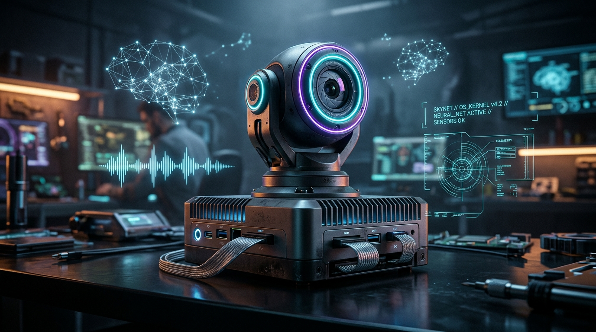

# <p align="center">🤖 SKYNET ROBOT</p>

<p align="center">
  <strong>Agente Físico Conversacional Multimodal com Gemini Live, Visão Computacional, PTZ Motorizado e Memória Temporal RAG</strong>
</p>

<p align="center">
  
</p>

<p align="center">
  <a href="https://python.org"></a>
  <a href="https://ai.google.dev"></a>
  <a href="https://webrtc.org"></a>
  <a href="https://onvif.org"></a>
  <a href="https://www.sqlite.org"></a>
  <a href="https://debian.org"></a>
  
</p>

---

## ⚡ Visão Geral

O **SKYNET Robot** transforma um TV Box barato (Debian armhf/arm64) e uma câmera IP PTZ comum (Yoosee / Gwelltimes) em um **robô físico inteligente e consciente do ambiente**.

Alimentado pelo **Google Gemini Live (3.8)**, o Skynet processa áudio bidirecional em tempo real, enxerga através da câmera via RTSP sob demanda ou continuamente, controla motores de Pan e Tilt (PTZ) via ONVIF, reconhece moradores por biometria facial local e preserva uma **memória temporal de longo prazo** estruturada com RAG híbrido.

### 🌟 Destaques Principais

- 🎙️ **Conversação por Voz Real-Time:** Conexão WebSocket persistente com o Gemini Live (áudio in/out ultrarrápido).
- 🎧 **Cancelamento de Eco Acústico WebRTC AEC3 (C++ nativo):** Suporte nativo a *barge-in* (interromper o robô enquanto ele fala) com cancelamento da própria voz em tempo real no TV Box.
- 👁️ **Visão Computacional & Biometria Facial:** Detecção e reconhecimento facial local com persistência SQLite (`data/people.db`), scores de confiança e injeção contextual em fotos para a IA.
- 🦾 **Controle Motorizado PTZ Adaptativo:** Engenharia reversa ONVIF SOAP contornando as limitações do firmware Yoosee através de micro-passos calibrados (~8°/passo) e cadência de pulso.
- 🧠 **Memória Temporal RAG v2 (4 Camadas):** Separação cognitiva estrita entre *Estado Atual (RAM)*, *Memórias Episódicas (passado datado)*, *Conhecimento Semântico (fatos vigentes com supersessão)* e *Planos Futuros (tarefas pendentes)*.
- 🕒 **Sincronizador Inteligente de Relógio:** Auto-sincronização de data/hora (NTP com fallback HTTP Date) e fuso (`America/Sao_Paulo`) no boot, eliminando erros de certificado TLS em TV Boxes sem bateria de RTC.
- 🖥️ **CLI Global & Gerenciamento de Serviço:** Comando global `skynet`, sessões desacopladas em `tmux`, logs em tempo real, TUI de setup e watchdog de auto-reinicialização.

---

## 🏗️ Arquitetura do Sistema

```mermaid
flowchart TD
    subgraph Hardware ["Ambiente Físico & Hardware"]
        CAM["📷 Câmera IP Yoosee / ONVIF"]
        BOX["📺 TV Box (Debian ARM)"]
        MIC["🎤 Microfone (USB ou RTSP)"]
        SPK["🔊 Caixa de Som (P2 / AV / USB)"]
    end

    subgraph AudioEngine ["Engenharia de Áudio"]
        AEC["⚙️ WebRTC AEC3 (libskynet_aec.so)"]
        REF["Far-End Speaker Ref"]
        GAIN["Ganho Digital (mic_gain)"]
    end

    subgraph CoreLoop ["Skynet Core Loop (main.py)"]
        LIVE["🌐 Gemini Live Client (WS)"]
        VOICE["🎙️ Voice Agent"]
        FC["⚡ Function Calling Dispatcher"]
    end

    subgraph PerceptionVision ["Percepção & Visão"]
        RTSP["FFmpeg RTSP Stream Buffer"]
        FACE["👤 Biometria Facial Local (people.db)"]
        JPG["Image Processor (Resize / JPEG)"]
        PTZ_CTRL["🦾 ONVIF PTZ Controller"]
    end

    subgraph MemoryEngine ["Memória Temporal RAG v2"]
        WM["Working Memory (RAM - TTL 30m)"]
        EP["Episodic (Eventos Passados Datados)"]
        SEM["Semantic (Fatos Vigentes & Superseded)"]
        PL["Plans (Intenções & Tarefas Futuras)"]
        RAG["Recuperador Híbrido: Vetores + SQLite FTS5"]
    end

    CAM -- "RTSP /onvif2" --> RTSP
    MIC --> GAIN --> AEC
    SPK <-- "Áudio PCM 24kHz" -- LIVE
    SPK -. "Loopback Ref" .-> REF --> AEC
    AEC --> VOICE --> LIVE
    LIVE <== "WebSocket Seguro" ==> CoreGemini["☁️ Google Gemini Live API"]
    
    LIVE --> FC
    FC -->|"capture_image"| RTSP
    RTSP --> JPG --> FACE --> FC
    FC -->|"move_camera"| PTZ_CTRL --> CAM
    FC <-->|"remember / recall"| MemoryEngine
    MemoryEngine -->|"Contexto em 4 Blocos"| LIVE
```

---

## 🧠 Arquitetura de Memória Temporal v2

> *"Memória não é percepção. Percepção não é conhecimento. Conhecimento não é estado atual."*

Para impedir que a IA alucine eventos do passado como se estivessem acontecendo agora, o contexto é entregue em **4 seções temporais explícitas**:

| Camada | Escopo | Armazenamento | Injeção no Prompt |
|---|---|---|---|
| **Working Memory** | O que está acontecendo agora (últimas falas, tarefa ativa, pessoas vistas no frame) | RAM (`memory/working.py`), TTL 30 min | `=== CURRENT STATE ===` |
| **Episodic** | Acontecimentos passados com data exata (`event_time`) | SQLite (`memory_type='event'`) | `=== EPISODIC MEMORIES ===` |
| **Semantic** | Fatos, preferências, relacionamentos e rotinas com validade temporal | SQLite (`fact`, `preference`, `routine`) | `=== SEMANTIC KNOWLEDGE ===` |
| **Future Plans** | Compromissos e tarefas futuras com status (`active`, `done`, `cancelled`) | SQLite (`plan`, `task`) | `=== FUTURE PLANS ===` |

Quando um fato se atualiza (ex: mudança de emprego ou cidade), o registro anterior não é apagado: torna-se `superseded` com data de expiração, e um novo registro é ativado com `valid_from`. Para documentação técnica aprofundada, veja [`memory/README.md`](memory/README.md).

---

## 📂 Arquitetura do Pacote Skynet

```
skynet/
├── main.py                   # ENTRADA PRINCIPAL: Agente de Voz Gemini Live
├── voice_chat.py             # Launcher alternativo para conversação por voz
├── ptz_console.py            # Console de calibração e controle manual de PTZ
├── calibrate.py              # Assistente interativo de medição graus/passo
├── config.py                 # Configurações de rede, hardware e motor
├── audio/                    # Módulo de áudio em tempo real
│   ├── live_agent.py         # Agente de voz Gemini Live (áudio + visão + PTZ)
│   ├── aec.py                # Pipeline WebRTC AEC3 (Python wrapper)
│   ├── player.py             # Reprodução ALSA em thread dedicada
│   ├── sources.py            # Captura de microfone (ALSA USB ou RTSP Câmera)
│   └── native/
│       ├── skynet_aec.cpp    # Cancelador de eco nativo C++ (WebRTC AEC3)
│       └── build_aec.sh      # Script de compilação da lib .so
├── camera/                   # Módulo de hardware da câmera
│   ├── ptz.py                # Controlador de pulsos e cadência ONVIF
│   ├── vision.py             # Capturas e snapshots legados
│   └── tracker.py            # Rastreamento de alvos
├── core/                     # Utilitários de infraestrutura
│   ├── alsa_detector.py      # Scan automático de placas de som ALSA
│   ├── config_tui.py         # Menu interativo TUI para setup no terminal
│   ├── env_manager.py        # Leitura e gravação de .env
│   └── time_sync.py          # Sincronização prévia de relógio (NTP/HTTP)
├── memory/                   # Memória temporal de longo prazo
│   ├── store.py              # SQLite v2 + FTS5 + temporal fields
│   ├── working.py            # Memória de trabalho (RAM, TTL 30m)
│   ├── rag.py                # Recuperação híbrida com ranking temporal
│   ├── consolidate.py        # Consolidação periódica da conversa
│   ├── tools.py              # Ferramentas da IA (remember, recall, forget)
│   └── README.md             # Guia técnico do subsistema de memória
├── scripts/                  # Scripts operacionais do TV Box
│   ├── skynet                # CLI global do robô (com suporte a TMUX)
│   ├── install_service.sh    # Instalador de serviço SysVinit / Systemd
│   ├── skynet.service        # Unidade Systemd
│   ├── skynet.init           # Script de serviço SysVinit
│   └── sync_time.py          # Script de sincronização de relógio no boot
├── tests/                    # Bateria de testes de áudio, PTZ, visão e RAG
└── vision/                   # Pipeline visual contínuo e reconhecimento
    ├── chat.py               # Chat de texto legado com function calling
    ├── camera_capture.py     # Captura persistente FFmpeg RTSP (slot único)
    ├── person_memory.py      # Reconhecimento facial local e biometria
    ├── image_processor.py    # Processamento de imagem e resize dinâmico
    ├── image_heartbeat.py    # Heartbeat visual a 1 FPS
    └── tools/                # Ferramentas expostas ao Gemini
```

---

## 🚀 Como Executar

### 1. Conversação por Voz (Gemini Live)
No terminal do TV Box:
```bash
# Execução direta com o microfone padrão (câmera IP)
python3 main.py

# Usando microfone USB conectado diretamente ao TV Box
python3 main.py --backend local --local-device default

# Ativando streaming de visão contínua (1 FPS)
python3 main.py --continuous-vision
```

### 2. Gerenciador Global em Background (`skynet`)
```bash
skynet start      # Inicia o robô em segundo plano na sessão tmux 'skynet'
skynet attach     # Abre o console interativo do robô (Ctrl+B depois D para sair)
skynet status     # Verifica se o serviço está ativo
skynet log        # Monitora os logs em tempo real
skynet stop       # Finaliza a execução
skynet tui        # Abre o menu interativo de configuração
```

### 3. Modo Chat de Texto (Legado / Debug)
```bash
python3 main.py --chat
```
- Conversa prioritariamente em texto.
- A IA aciona `capture_image` e `move_camera` sob demanda.
- Comandos disponíveis: `/foto`, `/parar`, `/pessoas`, `/memorias`, `/limpar`, `/sair`.

### 4. Console Manual de PTZ & Calibração
```bash
python3 ptz_console.py
```
- Digite `180` / `-90` para rotacionar em graus.
- Digite `t30` / `t-20` para inclinar (Tilt).
- Teclas `W`, `A`, `S`, `D`: micro-passos manuais.
- `F`: snapshot instantâneo.
- `SCAN`: varredura panorâmica com fotos.

---

## 🎧 Cancelamento de Eco Acústico (WebRTC AEC3)

O agente de voz utiliza o áudio enviado para o alto-falante como **sinal de referência (far-end)** e processa a captura do microfone (**near-end**) com o motor nativo **WebRTC AEC3** (`libskynet_aec.so`).

- Permite **barge-in**: você pode falar enquanto o Skynet está respondendo sem que a própria voz dele cause auto-interrupção ou microfonia.
- Compilação direta no TV Box (sem necessidade de GPU):
```bash
sudo bash audio/native/build_aec.sh
python3 tests/test_aec_offline.py
```
- Caso a biblioteca nativa não esteja compilada, o sistema opera automaticamente em modo **half-duplex inteligente** (`AUDIO_HALF_DUPLEX=auto`), silenciando temporariamente o microfone durante a fala da IA.

---

## ⚠️ Limitações Conhecidas de Hardware

Medições reais realizadas na câmera IP Yoosee (Gwelltimes, firmware 32.00.47):

| Cenário | Comportamento Observado | Solução Adotada no Skynet |
|---|---|---|
| `ContinuousMove` ONVIF | Retorna HTTP 200, mas move apenas um micro-passo (~8°) e cessa | Converte graus em passos discretos e espaçados |
| Taxa de comandos ONVIF | Comandos enviados com < 0.8s de intervalo são descartados pelo firmware | Cadência mínima de ~1.05s entre pulsos com buffer |
| Áudio RTSP na Câmera | Abrir áudio e vídeo RTSP em conexões paralelas pode travar o serviço RTSP (HTTP 405) | Recomendado microfone USB local no TV Box (`AUDIO_INPUT_BACKEND=local`) |
| Relógio de TV Boxes | Falta de bateria RTC causa perda da data/hora após desligamento | Sincronização obrigatória via `sync_time.py` antes de iniciar conexões TLS |

---

## 📄 Licença

Distribuído sob a licença **MIT**. Veja o arquivo `LICENSE` para detalhes.

<p align="center">
  Desenvolvido por <strong><a href="https://github.com/Mr4bb1t">Mr4bb1t</a></strong>
</p>
